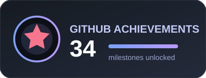

## 👋 About Me

I am a **Full Stack Developer** interested in combining modern web technologies with practical, AI-powered applications. I enjoy building end-to-end software, understanding application architecture, and improving how information moves through reliable systems.

**Building scalable full-stack applications and exploring intelligent AI systems.**

My current interests include:

- Building complete web applications with maintainable backend and frontend architectures.
- Developing RAG-based document question-answering systems grounded in uploaded knowledge.
- Exploring AI agents, tool calling, and multi-step AI workflows.
- Learning AI orchestration, structured outputs, validation, and retry strategies.
- Designing useful, responsible, and reliable Generative AI applications.

---

## 💻 Tech Stack

**Languages:**  

**Frontend:**   

**Backend & APIs:**  

**Databases:**  

**Tools & Platforms:**     

### Generative AI and LLMs

### Agentic AI and Orchestration

AI Agents · Agentic AI Workflows · Tool Integration · Workflow Orchestration · Multi-Step Processing · Context Management

### AI Reliability and Guardrails

Structured Output Validation · Schema Validation with Zod · Input and Output Validation · Error Handling · Retry Strategies · Responsible AI Application Design

---

## 🚀 Featured Projects

### AI-Powered GitHub PR Review Bot

An AI-assisted code review application that analyzes GitHub pull requests for potential bugs, security concerns, performance issues, and code quality improvements.

`Node.js` `JavaScript` `GitHub API` `Octokit` `Inngest` `Mistral AI` `Zod`

### Smart Restaurant Assistant

An AI-powered restaurant chatbot for menu questions and dish recommendations based on budget, meal category, dietary preferences, and spice level. Includes AI tool calling and persistent conversation history.

`Node.js` `Express.js` `MongoDB` `Mongoose` `LangChain` `Google Gemini`

### Bhojpuri Multilingual Document QA System

A document question-answering system enabling users to ask questions in Bhojpuri and receive answers grounded in uploaded documents. The system explores PDF text extraction, chunking, embeddings, vector search, multilingual question answering, and reranking.

`PDF Processing` `Chunking` `Embeddings` `Vector Search` `Multilingual QA` `Reranking`

### Smart Waste Management System

A waste management application focused on improving collection operations through route planning, collection point management, map-based route visualization, and optimized collection routes.

`Full Stack Development` `Maps` `Route Planning` `Collection Management` `Optimization`

---

## 📊 GitHub Stats

### GitHub Overview

### Contribution Streak

### Most Used Languages

### Contribution Activity

---

## 🏆 GitHub Achievements

### Achievement Badge

### GitHub Trophies

---

## 🌱 Currently Exploring

- Advanced RAG pipeline architecture
- Retrieval optimization and reranking techniques
- Agentic AI architectures and tool ecosystems
- AI workflow orchestration
- AI guardrails and structured output validation
- Reliable and maintainable LLM application development

---

## 🤝 Connect With Me

---

### Focused on building reliable software and intelligent systems.

*Full Stack Development × Generative AI × RAG × Agentic Workflows*
